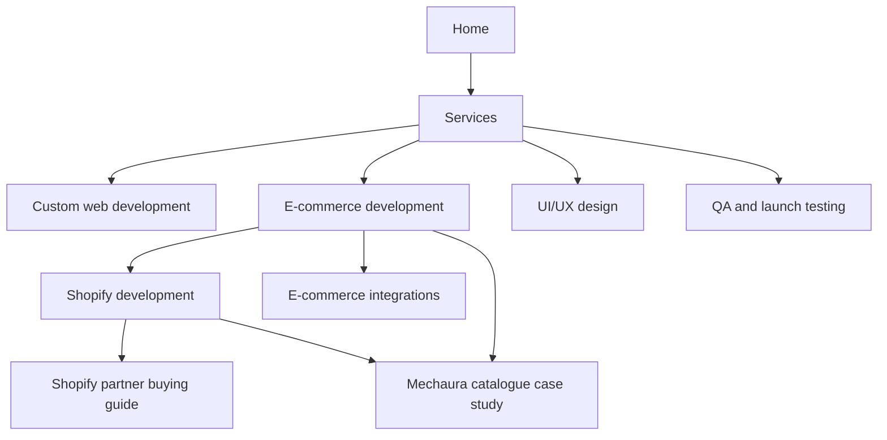

# SEO audit implementation — 7 November 2026

## Evidence and scope

Reviewed the supplied HTML growth plan and all four Search Console ZIP exports. The export filename is not the observation date: coverage ends 23 October (51 indexed, 21 excluded), search performance ends 4 November, and video coverage ends 5 November. Web performance contains 18 clicks and 388 impressions (4.64% CTR); UAE contributes 16 clicks and 261 impressions. These are small historical samples, not a forecast. AI search export contains four impressions, not four leads.

Connected Search Console inspection confirms homepage, Shopify and e-commerce service URLs are submitted and indexed with matching canonicals. The web-design and subscription URLs are valid redirects. A live technical sweep checked all 55 sitemap URLs: HTTP 200, one H1, indexable metadata and matching canonical. The 18 noindex templates are deliberate: 16 unsupported nonlocal locations and two replaced case studies. Exclusion totals alone do not establish defects. The exports omit affected URL examples for the 404, alternate canonical and five discovered URLs, so those individual cases remain unidentified.

## Implemented

- Corrected Shopify/e-commerce capability action labels and their destinations; replaced generic Shopify descriptions with scoped deliverables.
- Added distinct platform-selection, catalogue, migration, payment-provider, cost ownership, testing and support guidance. Shopify UAE payment eligibility links to current official documentation; no unverified prices or timelines were invented.
- Replaced repeated unrelated portfolio cards on commerce pages with original Mechaura catalogue imagery and explicit limitations. This is catalogue/enquiry evidence, not a checkout or Shopify sales-result claim.
- Added relevant guide-to-service and service-to-service links while retaining canonical URLs and established redirects.
- Repaired the homepage H1-to-H3 skip with a descriptive H2 before the circuit board.
- Added visible breadcrumbs and matching BreadcrumbList to indexable inner pages; updated Organization logo and confirmed social profile URLs.
- Added `generate_lead` only after an accepted, persisted JSON enquiry. Honeypot responses, validation failures and API errors do not count. Added `whatsapp_click` separately; no submitted contact data is attached to events.
- Retained the directly requested GA4 tag. Published GTM-PQJ2FVX5 resource version 1 has no tags, predicates or rules; duplicate pageviews are not established. Recheck if GTM changes.

## Information architecture and ownership

Broad website enquiries belong to custom-web-development; cross-platform retail buying questions belong to ecommerce-development; Shopify/Liquid questions belong to shopify-development. Existing blog slugs are retained because their inbound-link history is unknown. Case-study pages retain real scope and original media.

## External and ongoing actions

1. Configure `www.nexpixels.com` in the DNS/hosting account and redirect it to the apex. The www hostname currently returns ENOTFOUND. Apex HTTP correctly redirects to HTTPS; repository code cannot create a DNS record.
2. Connect GA4 to OpenSEO, verify real event ingestion in GA4 Realtime/DebugView, and mark `generate_lead` as a key event. OpenSEO reports GA4 is not connected. Qualification and revenue must come from the actual sales process; WhatsApp clicks alone are not leads.
3. In Search Console, inspect the five discovered URLs and the exact excluded URL examples, request indexing for materially updated pages, and revalidate only genuine fixed issues. Google controls crawl/index decisions.
4. Supporting project videos do not have watch pages as their main purpose. Retain them as supporting media; no fake watch pages, VideoObject dates or ratings were added to clear an eligibility report.
5. Obtain owner-approved Shopify checkout evidence, client references, actual outcomes and genuine business directory/profile details. No outreach messages were sent and no endorsements fabricated.
6. OpenSEO's existing default market is US (2840); research and the manual tracker use explicit UAE (2784). Update the project default in settings. No recurring checks, paid keyword runs or spending were started.
7. Compare consecutive 28-day UAE brand/non-brand query and page performance, accepted leads and qualified sales enquiries. Prioritize improving the existing service pages before scaling location or generic keyword pages.

No ranking or complete indexing guarantee is possible. A numerical SEO score is omitted because field Core Web Vitals and conversion-account data were not available.

## Primary references

- [Google indexing report](https://support.google.com/webmasters/answer/7440203?hl=en)
- [Google breadcrumbs](https://developers.google.com/search/docs/appearance/structured-data/breadcrumb)
- [Google Organization data](https://developers.google.com/search/docs/appearance/structured-data/organization)
- [Google video requirements](https://developers.google.com/search/docs/appearance/video)
- [GA4 recommended events](https://developers.google.com/analytics/devguides/collection/ga4/reference/events)
- [Shopify UAE payment requirements](https://help.shopify.com/en/manual/payments/shopify-payments/supported-countries/united-arab-emirates)
